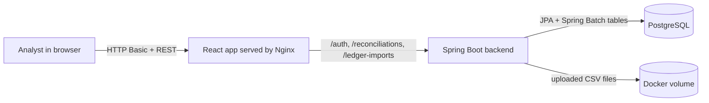
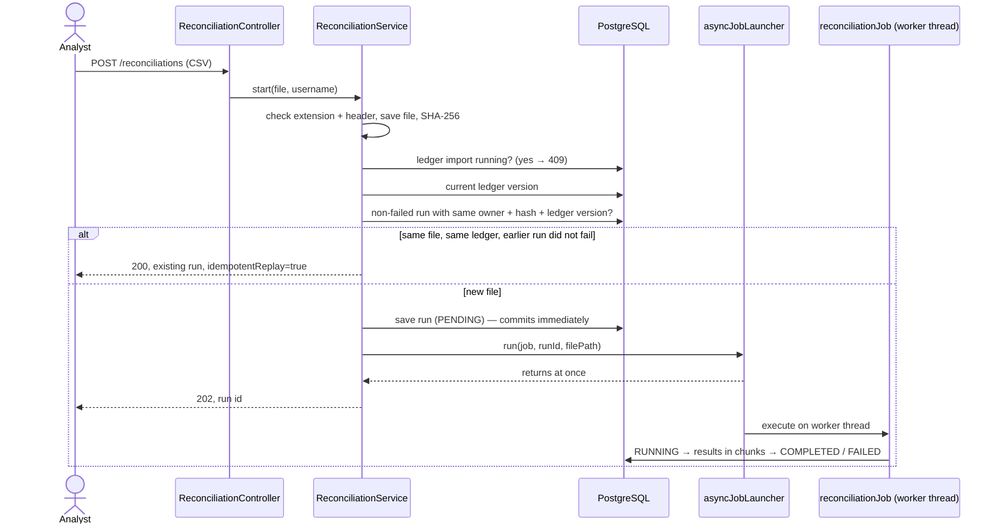
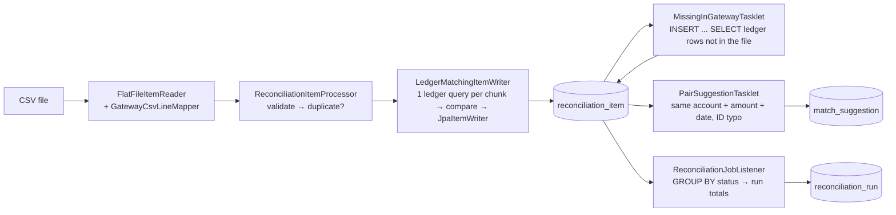
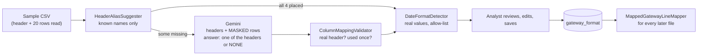
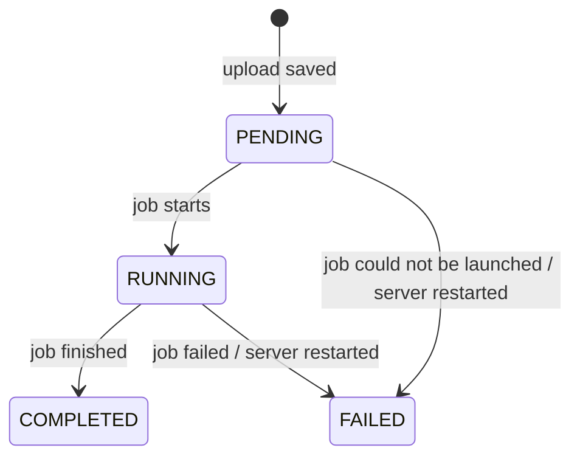

# Architecture

BalanceTrail is one Spring Boot application, one React application and one PostgreSQL database.

## Packages

| Package | What lives there |
|---|---|
| `controller` | REST endpoints, status codes, request parameters |
| `service` | Upload flow, file storage, run status updates, matching rule |
| `batch` | CSV line mappers, processors, chunk writers, duplicate detector, ledger-only tasklet, job listeners |
| `repository` | Spring Data JPA repositories |
| `entity` | JPA entities (database rows) |
| `dto` | API response records; entities are never returned directly |
| `domain` | Enums and small value records |
| `config` | Spring Batch jobs, Security, OpenAPI, startup user, restart recovery |
| `security` | Loads users from the database for login |
| `exception` | Custom exceptions and the global error handler |

## Upload flow

`ReconciliationService.start()` is not `@Transactional`, so `runRepository.save()` commits before the job is launched. The worker thread therefore always finds the run row.

The launcher uses a thread pool with 2 threads, shared by reconciliations and ledger imports. Two jobs can run at the same time; more uploads wait in the pool's queue.

## Batch job

One job, three steps. Step 1 reads the file in chunks of 100. Step 2 looks the other way: ledger rows the file never mentions. Step 3 suggests pairs between the leftovers of steps 1 and 2.

- The **reader** reads one line at a time. `GatewayCsvLineMapper` splits it into 4 text columns; for a file in a saved gateway format, `MappedGatewayLineMapper` picks the four mapped columns and converts the date to `yyyy-MM-dd` (see Gateway formats). A broken line (wrong column count, unclosed quote) is kept with a `parseError` instead of crashing the job.
- The **processor** validates the line and checks for duplicates. It does not touch the database. It returns either a finished result (`INVALID`, `DUPLICATE`) or "this line still needs its ledger row".
- The **writer** collects the transaction IDs of the whole chunk, loads their ledger rows with one `SELECT ... WHERE transaction_ref IN (...)`, compares each line with `TransactionMatcher`, and saves the chunk's 100 results in one database transaction. Before, the processor ran one `SELECT` per line.
- **Step 2** runs one SQL statement: insert a `MISSING_IN_GATEWAY` row for every ledger row dated between the file's first and last date that no line of this run mentions. The database does the work; nothing is loaded into Java.
- The **job listener** marks the run `RUNNING` before the job, and after it either stores the counts (`COMPLETED`) or the error message (`FAILED`).

If the database throws a temporary error while writing a chunk, the chunk is rolled back and tried again, up to 3 attempts in total with exponential back-off (100 ms, then 200 ms). The writer builds fresh result objects on every attempt, so a retry can't save a result twice. A permanent error fails the job.

### Why "one query per chunk" needed an ANALYZE

PostgreSQL caches the plan of a prepared query per connection. Right after a large ledger load, the cached plan for the `IN (...)` lookup could still be the one made when the ledger was small (a full table scan), and a 100,000-row run took 56 s instead of 14 s until auto-analyze caught up. The ledger import job therefore runs `ANALYZE ledger_transaction` when it finishes, which refreshes the statistics and throws away the old plans. The old one-row lookup (`WHERE transaction_ref = ?`) always used the primary key, which is why this only showed up after batching.

## Outcomes

| Condition | Status |
|---|---|
| Row is malformed or a field is invalid | `INVALID` |
| Transaction ID already appeared on an earlier line of this file | `DUPLICATE` |
| No ledger row with this transaction ID | `MISSING_IN_LEDGER` |
| Ledger row found, amount differs (`BigDecimal.compareTo`) | `AMOUNT_MISMATCH` |
| Amount equal, account number differs | `ACCOUNT_MISMATCH` |
| Amount and account equal, dates more than `app.matching.date-tolerance-days` (default 2) apart | `DATE_MISMATCH` |
| Amount, account and date (within tolerance) agree | `MATCHED` |
| Ledger row dated inside the file's date range, no line of the file mentions it | `MISSING_IN_GATEWAY` |

When several fields differ, the status is the most serious difference (amount, then account, then date) and the reason lists every difference. The date tolerance exists because gateways usually settle a day or two after the ledger records a payment.

`totalCount` on a run is the number of CSV lines. `MISSING_IN_GATEWAY` rows come from the ledger, have no line number, and are counted separately (`missingInGatewayCount`).

**Assumption:** one gateway file covers every ledger payment in its date range. If a company receives several gateway files for the same days, step 2 would report the other gateways' payments as missing; the ledger would need a gateway column to scope the check.

## Duplicate detection

`DuplicateDetector` keeps a map of transaction ID → first line number seen, one map per job run. A later line with the same ID is a duplicate. The same line seen again is not, because a retried chunk processes its rows a second time.

## Suggested pairs ("probably the same payment")

A typo in a transaction ID shows up twice: once as `MISSING_IN_LEDGER` (the file's ID isn't in the ledger) and once as `MISSING_IN_GATEWAY` (the ledger's ID isn't in the file). Step 3 (`PairSuggestionTasklet` + `PairSuggester`) puts the two side by side.

A pair is suggested only if all of these hold:

| Rule | Why |
|---|---|
| Same account number and same amount | Exact facts; a typo in the ID doesn't change them |
| Dates within the matching tolerance (2 days) | Same settlement-delay rule as normal matching |
| IDs at most 2 characters apart (Levenshtein distance, case and spaces ignored) | "TXN-1008" vs "TXN-10088" or "TXN-1O08" is a typo; "TXN-1008" vs "PAY-77" is a different payment |

How it stays cheap and safe:

- Only the leftover rows of the run are loaded (7% + 2% of a 100,000-row benchmark file). They are grouped by (account, amount), so only rows in the same group are compared, and the edit distance stops counting once it passes 2. Measured: about 0.1 s for 7,000 × 2,000 leftovers.
- **No guessing.** If a row fits more than one partner, every pair it is in is marked `ambiguous`, and the analyst decides.
- **Nothing is automatic.** The analyst confirms ("same payment") or rejects (with an optional note). Who decided and when is stored. The two original results are never changed, so the audit trail shows both what the data said and what the analyst concluded.
- Confirming a pair closes the other open suggestions that use either of its rows, because a row can only be one payment. Partial unique indexes make "at most one confirmed pair per row" a database rule too, in case two requests confirm at the same moment.
- Not attempted on purpose: one-to-many matches (one ledger row settled as several gateway rows). Finding which rows add up to a total is the subset-sum problem.

## Gateway formats and AI column mapping

Real gateway exports don't use our 4 columns: `Txn Ref`, `Acct No`, `Amount (INR)`, `Settlement Dt`, dates like `09/07/2026`, extra columns like email or status. A **gateway format** is a saved mapping for one gateway's layout. It's made once from a sample file and then used for every later file from that gateway.

**Deterministic where the money is, AI only for the tedious first guess.** Everything after the mapping is saved is plain code: picking columns by position, converting dates with a fixed format, then the same validation and matching as any other file. The AI only proposes which header is which field, and it's optional.

Guardrails, in the order they apply:

1. **Rules first.** `HeaderAliasSuggester` knows the common names (`Txn Ref`, `UTR No`, `Amount (INR)`, `Settlement Dt`, ...). Only if it can't place all four columns is the AI asked. So common layouts cost nothing, take no time, and nothing leaves the server. The rules never guess: "Gross Amt" vs "Net Amt" is left for the AI or the analyst.
2. **Masking.** The AI sees the header names and up to 5 sample rows with every digit shown as 9 and every letter as a/A (`ACC-100234` → `AAA-999999`, `ravi@x.in` → `aaaa@a.aa`). Real account numbers, emails and amounts never leave the server; sending customers' personal data to a third party is something India's DPDP Act makes you avoid by default. A "header" that looks like data (5+ digits in a row, i.e. a file without a header row) is masked too.
3. **Constrained answer.** The request asks for JSON whose four fields can only be one of the file's own headers or `NONE` (an `enum` in the response schema), with temperature 0.
4. **Prompt injection.** Header names come from an uploaded file, so the prompt says they are data, not instructions. Even if a header tried to instruct the model, the worst outcome is a wrong mapping, because of 5 and 6.
5. **Validation.** `ColumnMappingValidator` drops any answer that isn't a real header or that uses a header twice. Code fences, "thought" parts, blocked or empty answers, timeouts (10 s) and HTTP errors all lead to the same fallback: header rules plus a warning.
6. **Dates are never asked of the AI.** `DateFormatDetector` tries a fixed allow-list of formats on the real (unmasked) sample dates locally. If samples fit both `dd/MM` and `MM/dd` (every day ≤ 12), the analyst is told and must choose. One stray bad date in the sample doesn't stop detection.
7. **The analyst confirms.** Nothing is saved until the analyst reviews the mapping, and the UI shows exactly what an AI would see. The saved format records whether the first suggestion came from `GEMINI`, `HEADER_RULES` or was `MANUAL` (the analyst changed it).
8. **Formats are immutable.** A run records which format read its file, and the format is part of the "same upload again?" key. Changing a format would silently change what old runs mean, so a corrected mapping is saved as a new format.
9. **Measured, not assumed.** `src/test/resources/mapping-eval/cases.json` holds 12 realistic header sets with the right answer. The rules are checked against it in every build (they must map the common ones exactly and never map a field wrongly). `GeminiEvalTest` runs the real Gemini API against it and requires ≥ 90% of fields right; it only runs when `GEMINI_API_KEY` is set, so normal builds and CI never call Google.

The Gemini call uses the `generateContent` REST API (`/v1beta/models/{model}:generateContent`, key in the `x-goog-api-key` header, answer schema in `generationConfig.responseFormat`). The model is configurable (`GEMINI_MODEL`, default `gemini-3.8-flash`).

**Amounts:** a format maps columns and dates, nothing more. Amounts must still be plain numbers (`1250.00`); `1,250.00` or `₹1250` become `INVALID` lines, and the suggestion warns about it when the sample shows such values.

## Same file uploaded twice

A result depends on two things: the file and the ledger. So a run stores the file's SHA-256 hash and the **ledger version** it was compared against (the id of the latest ledger import, 0 for the seeded demo ledger).

The service reuses an earlier run only if owner, hash and ledger version all match **and** that run did not fail. The database backs this with a partial unique index on `(owner_id, file_sha256, ledger_version) WHERE status <> 'FAILED'`. If two identical uploads arrive at the exact same moment, the index rejects the second one and the API returns 409.

Since 0.3.0 the gateway format is part of the key too (`COALESCE(gateway_format_id, 0)` in the index), because the same bytes read with a different mapping can give a different result.

So: the same file again → the same run (200). The same file after a ledger import → a new run against the new ledger (202). The same file after a failed run → a new run (202); this is how a failed run is retried.

## Ledger imports

`POST /ledger-imports` takes a CSV with `transaction_id,account_number,amount,transaction_date,description`. It runs as its own Spring Batch job with the same shape as the reconciliation job and the same validation rules (`FieldRules`):

- valid lines are **upserted**: a new transaction ID is inserted, an existing one is updated (`INSERT ... ON CONFLICT DO UPDATE`), so a corrected ledger fixes old values;
- rejected lines (bad field, or the same ID twice in one file) go to `ledger_import_error` with their line number and reason;
- both statements are safe to repeat, so a retried chunk does no harm;
- at the end the job runs `ANALYZE ledger_transaction` (see above).

The ledger is the company's books, so it is shared: every analyst sees every import.

**Not at the same time:** a ledger import is refused (409) while any reconciliation or other ledger import is running, and a reconciliation upload is refused (409) while a ledger import is running. Otherwise half a file could be compared with the old ledger and half with the new one. The check and the insert are two separate steps, so two requests in the same instant could both pass; a database lock would close that gap.

## Restart recovery

A job lives in the server's memory. If the server stops mid-job, the run would show `RUNNING` forever (and a stuck ledger import would block every new upload). `InterruptedWorkRecovery` runs at startup, after Flyway and before the web server accepts requests, and marks every `PENDING`/`RUNNING` run and ledger import as `FAILED` with "Server stopped before this job finished". The user retries by uploading the same file again. This assumes one backend instance.

## CSV export

`GET /reconciliations/{id}/discrepancies/export` streams every non-matched row as CSV, 1,000 rows at a time from the database straight to the response. Cells that start with `=`, `+`, `-` or `@` get a leading apostrophe so Excel won't run them as formulas, since IDs in the export come from an uploaded file.

## Run statuses

## Security

Users are stored in PostgreSQL with BCrypt password hashes. Every request uses HTTP Basic authentication (no sessions). Every run query includes the logged-in username, so user A gets 404 for user B's run even with the right UUID. HTTP Basic is fine on localhost; a hosted version would need HTTPS.

## Errors

| Situation | Response |
|---|---|
| Not a `.csv`, empty, or wrong header | 400 |
| File over 25 MB | 413 |
| Not logged in | 401 |
| Run doesn't exist or isn't yours | 404 |
| Ledger import running (or, for a ledger import, anything running) | 409 |
| Database constraint violated | 409 |
| Anything unexpected | 500, details only in the server log |

## Known limitations

- Step 2 assumes one gateway file per date range (see Outcomes).
- Suggested pairs are one-to-one only; split payments are not detected.
- Gateway formats don't handle thousands separators, currency symbols or Excel files.
- The real Gemini call is covered by the eval test only when an API key is present; CI tests it against a fake HTTP server.
- The "is anything running?" check can be passed by two requests arriving in the same instant.
- Restart recovery assumes a single backend instance.
- Uploaded files are kept on disk with no clean-up job.
- Only single-line, comma-separated UTF-8 CSV is supported.
