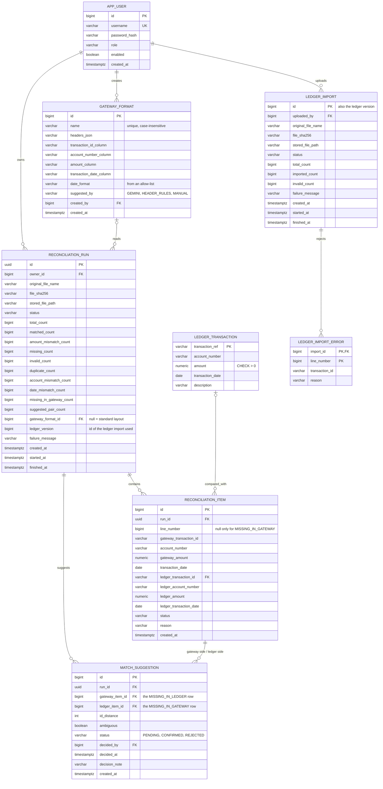

# Database / ER Diagram

## Constraints and indexes

| Object | Why it exists |
|---|---|
| `uk_app_user_username` | No two users with the same login |
| `ck_ledger_amount_positive` | Ledger amounts must be greater than zero |
| `uk_run_owner_hash_ledger_format (owner_id, file_sha256, ledger_version, COALESCE(gateway_format_id, 0)) WHERE status <> 'FAILED'` | One live run per user, file, ledger version and format; failed runs don't block a retry |
| `uk_suggestion_pair (gateway_item_id, ledger_item_id)` | A pair is suggested once; makes a re-run of step 3 a no-op |
| `uk_suggestion_confirmed_gateway_item`, `uk_suggestion_confirmed_ledger_item` (partial, `WHERE status = 'CONFIRMED'`) | A row can be in at most one confirmed pair, even with two requests at once |
| `uk_gateway_format_name (lower(name))` | Format names are unique, ignoring case |
| `uk_item_run_line (run_id, line_number)` | One result per CSV line |
| `ck_item_line_number` | Only `MISSING_IN_GATEWAY` rows may have no line number |
| `ck_run_status`, `ck_item_status` | Only known status values can be stored |
| `idx_run_owner_created` | Run history: my runs, newest first |
| `idx_item_run_status_line` | Discrepancy page: this run's non-matched rows in line order |
| `idx_item_run_gateway_id` | Step 2: "does this run mention this ledger ID?" |
| `idx_ledger_transaction_date` | Step 2: "ledger rows inside the file's date range" |
| `idx_ledger_import_created` | Ledger import list, newest first |
| `ledger_import_error` primary key `(import_id, line_number)` | One reason per rejected line; makes a retried chunk's insert a no-op |

Ledger lookups by ID use the `transaction_ref` primary key, so they need no extra index.

`reconciliation_item` ids come from a sequence that hands out 100 values at a time (`allocationSize = 100`). Step 2's `INSERT ... SELECT` uses the column's `DEFAULT nextval(...)` on the same sequence, so its rows can never get an id Hibernate is also using. With an identity column Hibernate would have to insert rows one by one to learn each id; with a sequence it can send the 100 inserts of a chunk as one JDBC batch.

Spring Batch also creates its own `BATCH_*` tables in the same database to record job and step executions. They are left out of the diagram above.
